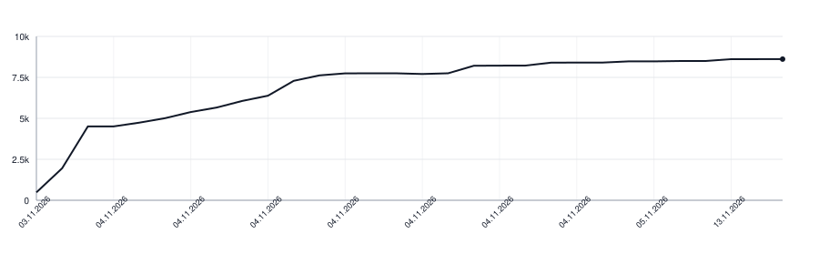

# LetterGrid for Kotlin

[](https://github.com/apakabarlabs/lettergrid-kotlin/actions/workflows/tests.yml)
[](https://apakabarlabs.github.io/lettergrid-kotlin/)

Build and play word searches in Kotlin, with optional Compose views. This is the Kotlin port of
[lettergrid-swift](https://github.com/apakabarlabs/lettergrid-swift): the same names, and the
same seed gives the same board.

```kotlin
import fm.apakabar.lettergrid.*

val rules = listOf(WordRule.straight(listOf(Direction.RIGHT, Direction.DOWN)))
val generator =
    BoardGenerator(
        size = BoardSize(columns = 7, rows = 7), rules = rules,
        filler = Filler(LetterWeights(mapOf("x" to 1.0, "q" to 1.0, "z" to 1.0))),
    )
val board = generator.board(listOf("cat", "dog", "sun"), seed = 42uL)
val round = Round(board, rules = rules)
```

| The library | The app |
|---|---|
| placement, selection, hints, optional countdown | game rules, levels, scores, persistence, colours |

Compose apps draw the board with `LetterBoard` from `lettergrid-kotlin-ui`, in the colours of
the app's theme; what a game shows around the board, such as the words to find, is the game's
own:

```kotlin
val style =
    LetterGridStyle(
        found = colors.foundWord, selected = colors.selectedWord, rejected = colors.missedWord,
        hinted = colors.hintedLetter, rejectionSeconds = 0.6,
    )
LetterBoard(
    round, style,
    actions = LetterBoardActions(
        onTouch = round::touch, onDrag = round::drag,
        onRelease = { round.release() }, onRejectionShown = round::clearRejection,
    ),
)
```

## Install

Both artifacts are on Maven Central:

```kotlin
repositories {
    mavenCentral()
}

dependencies {
    implementation("fm.apakabar:lettergrid-kotlin:0.26.0")
    implementation("fm.apakabar:lettergrid-kotlin-ui:0.26.0") // only for Compose
}
```

The core is plain Kotlin on JVM 17; the views need Android 9 (API 28) or later. The API is not
settled before 1.0 and may change between minor versions.

## Paths with turns

Pass the same `rules` to the generator and the round.

```kotlin
val straight = WordRule(Direction.entries)
val bent = WordRule(listOf(Direction.RIGHT), turns = 2)
val generator =
    BoardGenerator(
        size = BoardSize(columns = 7, rows = 7), rules = listOf(straight, bent),
        filler = Filler(LetterWeights(mapOf("x" to 1.0, "q" to 1.0))),
    )
val request = generator.request(listOf("planet", "star"), firstRule = bent)
val round = Round(request.board(seed = 42uL), rules = listOf(straight, bent))
```

To require different rules for the first few words, pass `leadingRules`. Each rule applies to
the word at the same index; later words may use any enabled rule. A leading rule can narrow an
enabled rule's starting directions while keeping its turn count.

```kotlin
val request =
    generator.request(
        listOf("planet", "star", "sun"),
        leadingRules = listOf(WordRule(listOf(Direction.RIGHT)), WordRule(listOf(Direction.RIGHT), turns = 2)),
    )
```

- `accepts(words, leadingRules)` runs the preliminary word and quota checks. Accepted words may
  still fail the placement or fill search in `request`.
- `checkPlacement(words)` searches for target paths without filling the remaining cells, and
  takes the same `firstRule` or `leadingRules` as `request`. Success does not
  guarantee that filler can complete the board: call `request` for the chosen words and handle
  its failure before showing a board.
- `limits = PlacementLimits(maxWordsPerDirection = 2)` limits how many targets start in each
  direction. A turned word counts by its first segment, and opposite directions count
  separately. A limit must be positive, or the checks fail with `InvalidConfiguration`; too
  little room fails with `NoRoom`.

Every failure of the generator is a `BoardGenerator.Failure`.

`BoardSize.maxRows` defaults to `null`, so boards may grow downwards. `Filler` holds the
letter weights and optional `conditionalCharacters`. `PlacementLimits` also accepts
`downWords`, which counts targets starting up or down; both limits default to no limit.
`RoundOptions(seconds = 60, introduces = true, hintOrder = HintOrder.ANY_BUT_FIRST)` groups
round settings; by default there is no clock, no introduction, and hints start at the first
letter. For straight rules, a drag snaps to the nearest allowed direction, ties follow the
order of the rules' start directions, and dragging past the board stops at its last cell.

## Saving a game

A seed alone does not keep a layout across library updates. Save the board's letters and
placements together with `round.progress`, and restore them through the checking functions,
which throw instead of stopping the app:

```kotlin
val placements = saved.map { Placement.validating(it.word, it.cells) }
val board = Board.validating(letters, placements)
val round = Round.restoring(savedProgress, board, rules = rules, options = RoundOptions(seconds = 60))
```

## Differences from Swift

| Swift | Kotlin |
|---|---|
| A cell holds a `Character` | A cell holds one grapheme as a `String`, split by `String.cells`, since a `Char` cannot hold one |
| `Board(validating:placements:)`, `Placement(validating:cells:)`, `Round(restoring:...)` | `Board.validating`, `Placement.validating`, `Round.restoring` |
| `Round` is `@Observable` | `Round.changes` is a `StateFlow` that moves on every change, and the views collect it |
| `Countdown.run` returns when cancelled | `Countdown.run` suspends, and cancellation ends it with `CancellationException` |
| `SeededRandom.nextInt(below:)` takes a 64-bit `Int` | `nextInt(below)` takes an `Int` and `nextLong(below)` a `Long`, drawing the same stream |
| `SleepInterval` is visible to the package only | `SleepInterval` is public, since the views are another module |
| Sensory feedback and SwiftUI animations | `HapticFeedback` and Compose animations with the same timing |

## Documentation

The [Dokka API reference](https://apakabarlabs.github.io/lettergrid-kotlin/) is generated from the
public Kotlin API and deployed by GitHub Actions. The
[changelog](https://github.com/apakabarlabs/lettergrid-kotlin/blob/main/CHANGELOG.md) lists the
changes between versions.

## Build and test

```bash
make build                                # lint, tests, documentation, both modules
make test                                 # tests, no device
make test TEST=<class>                    # one test class of the core
make docs                                 # the Dokka reference
make -C ../lettergrid-swift sync-yaml     # after the shared cases or generation.yaml change there
make release                              # publish the version of CHANGELOG's first heading
```

The shared cases and `generation.yaml` are copies of lettergrid-swift's, and a test compares
each with its `main` byte for byte. `make release` starts the
[Release workflow](https://github.com/apakabarlabs/lettergrid-kotlin/actions/workflows/release.yml)
on `main` for the version of the first heading in CHANGELOG.md.

## Lines of Code

<picture>
  <source media="(prefers-color-scheme: dark)" srcset="https://raw.githubusercontent.com/apakabarlabs/lettergrid-kotlin/main/.github/loc-history-dark.svg">
  <source media="(prefers-color-scheme: light)" srcset="https://raw.githubusercontent.com/apakabarlabs/lettergrid-kotlin/main/.github/loc-history-light.svg">
  
</picture>
